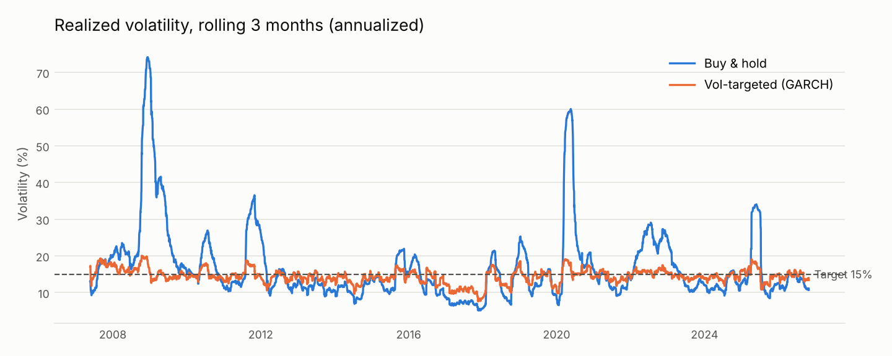

# Volatility Targeting on the S&P 500

Does sizing your stock position to forecast risk (more when markets are calm, less when they're wild) actually help? This project forecasts daily volatility with four models, from a rolling average to GARCH, runs a walk-forward backtest on SPY from 2007 to 2026 with trading and borrowing costs, and tests whether the results are statistically real.



## Findings

**1. It works as risk control.** Every volatility-targeted version held risk close to its 15% target, while buy-and-hold swung from under 10% to over 70%. The worst drawdown fell from **−56% to about −38%**, and losses in each crisis were roughly cut in half:

| Window | Buy & hold | Vol-targeted (GARCH) |
| --- | --- | --- |
| 2008 financial crisis | −47.1% | −21.9% |
| 2020 COVID crash | −33.4% | −14.6% |
| 2022 bear market | −24.1% | −17.9% |

**2. It does not reliably beat the market on risk-adjusted return.** Sharpe ratios rose from 0.60 to between 0.63 and 0.69, but a block bootstrap puts every improvement's 95% confidence interval across zero (for GARCH: +0.06, CI [−0.16, +0.27]). Twenty years of one market can't distinguish that gain from luck. Annual return was also slightly lower (8.9% vs. 10.3% for GARCH), partly because leverage costs money.

**3. The most accurate forecaster was not the best strategy.** GARCH had the lowest forecast error on both loss functions, yet its strategy ranked third. GARCH reacts quickly to new information, so it traded almost twice as much as the 21-day rolling average (11.4× vs. 6.4× the portfolio per year), and trading costs ate the difference. With zero costs, all four Sharpe ratios fall within about 0.03 of each other. The lesson: forecast accuracy and trading value are different targets, and a backtest without costs would have hidden this.

Full tables, including cost and rebalancing sensitivity: [results/results.md](results/results.md).

| | Rolling 21-day | EWMA | GARCH(1,1) | HAR | Buy & hold |
| --- | --- | --- | --- | --- | --- |
| Forecast QLIKE (lower = better) | −8.192 | −8.257 | **−8.316** | −8.221 | – |
| Sharpe ratio | **0.69** | 0.66 | 0.65 | 0.63 | 0.60 |
| Annual return | 10.0% | 9.3% | 8.9% | 8.4% | **10.3%** |
| Max drawdown | −38.6% | **−36.6%** | −38.1% | −37.6% | −56.5% |
| Annual turnover | 6.4× | 6.5× | 11.4× | 15.8× | – |

## Method

**Data.** Daily SPY closes from Stooq, Feb 2005 to Oct 2026. Stooq's prices are adjusted for dividends (the Feb 2005 close shows as ~$94 versus ~$121 traded), so returns approximate total return. The first two years train the models; results cover Feb 2007 onward.

**Forecasters**, each predicting tomorrow's volatility from data through today:

| Model | Idea |
| --- | --- |
| Rolling 21-day | Average squared return over the past month |
| EWMA (λ = 0.94) | Weighted average with exponentially fading memory (J.P. Morgan RiskMetrics) |
| GARCH(1,1), Student-t | Volatility reverts to a long-run level and jumps after large shocks; fat-tailed errors |
| HAR | Regression on last day's, week's and month's variance (Corsi, 2009) |

GARCH and HAR are **re-estimated every 21 trading days on an expanding window** and never see data from the period they forecast.

**Strategy.** Each day, weight = 15% ÷ forecast annual volatility, capped at 1.5×. Idle cash earns 0%, borrowing costs 3% a year, and every trade pays 5 basis points (0.05%). Positions are set at one day's close and earn the next day's return.

**Evaluation.**
- *Forecast accuracy* uses QLIKE and MSE against squared returns. Squared returns are a noisy stand-in for true variance, but Patton (2011) shows these two losses still rank forecasters correctly under that noise.
- *Significance* uses a circular block bootstrap with 21-day blocks. Volatility clusters, so resampling single days would understate uncertainty. Both strategies are resampled on the same days to keep their correlation.
- *Sensitivity* to trading costs and to a no-trade band is reported in `results/results.md`, not tuned. Picking the best band after seeing the results would be overfitting.

**No lookahead, tested.** `tests/test_voltarget.py` plants a huge fake return on one day and checks that no model's forecast for that day or earlier changes. It runs for all four models.

## Limitations

- One asset over one 20-year period. Results may differ for other assets or eras.
- Fixed 0% cash and 3% borrowing rates instead of actual historical interest rates.
- Daily closes only. Intraday data would give much better variance estimates, especially for HAR, which was designed for them.
- Trading at the close assumes market-on-close orders fill at the closing price.

## Run it

```bash
pip install -r requirements.txt
# Download SPY daily data from https://stooq.com/q/d/?s=spy.us ("Download data in csv file")
# and save it as data/spy_us_d.csv
python -m voltarget data/spy_us_d.csv   # writes results/results.md and charts
pytest                                  # 11 tests, including the no-lookahead test
```

## Structure

```
voltarget/
  data.py         load prices, log returns (for modeling) and simple returns (for P&L)
  forecasters.py  rolling, EWMA, walk-forward GARCH and HAR
  backtest.py     position sizing, costs, financing, rebalancing band
  metrics.py      Sharpe, drawdowns, crisis windows, QLIKE, block bootstrap
  report.py       runs everything, writes results/
tests/            no-lookahead, sizing, cost and metric tests
```

## Author

Darya Terani, Statistics and Economics, UC Davis. Extends the GARCH modeling from my financial econometrics coursework into an out-of-sample trading test.
