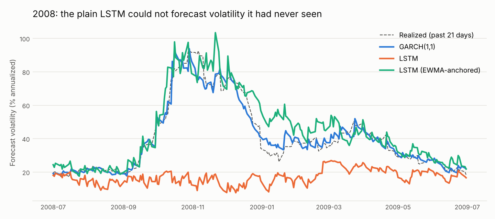

# Volatility Targeting on the S&P 500

Does sizing your stock position to forecast risk (more when markets are calm, less when they're wild) actually help, and do neural networks forecast that risk better than classical models? This project forecasts daily volatility with six models, from a rolling average through GARCH to two LSTM neural networks, runs a walk-forward backtest on SPY from 2007 to 2026 with trading and borrowing costs, and tests whether each result is statistically real.


## Findings

**1. Volatility targeting works as risk control.** Every classical version held risk close to its 15% target, while buy-and-hold swung from under 10% to over 70%. The worst drawdown fell from **−56% to about −38%**, and losses in each crisis were roughly cut in half:

| Window | Buy & hold | Vol-targeted (GARCH) |
| --- | --- | --- |
| 2008 financial crisis | −47.1% | −21.9% |
| 2020 COVID crash | −33.4% | −14.6% |
| 2022 bear market | −24.1% | −17.9% |

**2. It does not reliably beat the market on risk-adjusted return.** Sharpe ratios rose from 0.60 to between 0.63 and 0.69, but a block bootstrap puts every improvement's 95% confidence interval across zero (for GARCH: +0.06, CI [−0.16, +0.27]). Twenty years of one market can't distinguish that gain from luck.

**3. A plain neural network failed exactly when it mattered, and a structural fix made it the most accurate model.** Trained on calm years, the plain LSTM forecast about 15–20% volatility in late 2008 while real volatility passed 90%. Neural networks interpolate well but extrapolate badly, and the crash was outside anything in its training data. Its strategy lost 52% in the crisis, worse than buy-and-hold. Anchoring the network to the EWMA forecast, so it only learns a *correction* from scale-free inputs, fixed this: the anchored LSTM had the **lowest forecast error of all six models** and beat GARCH in 15 of 20 years. A Diebold-Mariano test puts that edge at p = 0.09: suggestive, not conclusive.



**4. The most accurate forecaster made the worst targeting strategy.** The anchored LSTM forecast best but produced the lowest Sharpe ratio of the working strategies (0.59, below buy-and-hold). Fast-reacting forecasts trade constantly: the LSTMs, GARCH and HAR turned over 11–16× the portfolio a year, against 6× for the simple rolling average, and trading costs ate the difference. The simplest model produced the best strategy. Forecast accuracy and trading value are different targets, and a backtest without costs would have hidden this.

| | Rolling 21-day | EWMA | GARCH(1,1) | HAR | LSTM | LSTM (anchored) | Buy & hold |
| --- | --- | --- | --- | --- | --- | --- | --- |
| Forecast QLIKE (lower = better) | −8.192 | −8.257 | −8.316 | −8.221 | −7.996 | **−8.338** | – |
| Sharpe ratio | **0.69** | 0.66 | 0.65 | 0.63 | 0.39 | 0.59 | 0.60 |
| Annual return | 10.0% | 9.3% | 8.9% | 8.4% | 5.4% | 7.6% | **10.3%** |
| Max drawdown | −38.6% | **−36.6%** | −38.1% | −37.6% | −65.8% | −38.2% | −56.5% |
| Annual turnover | 6.4× | 6.5× | 11.4× | 15.8× | 14.4× | 14.3× | – |

Full tables, including significance tests and cost and rebalancing sensitivity: [results/results.md](results/results.md).

## Method

**Data.** Daily SPY closes from Stooq, Feb 2005 to Oct 2026. Stooq's prices are adjusted for dividends (the Feb 2005 close shows as ~$94 versus ~$121 traded), so returns approximate total return. The first two years train the models; results cover Feb 2007 onward.

**Forecasters**, each predicting tomorrow's volatility from data through today:

| Model | Idea |
| --- | --- |
| Rolling 21-day | Average squared return over the past month |
| EWMA (λ = 0.94) | Weighted average with exponentially fading memory (J.P. Morgan RiskMetrics) |
| GARCH(1,1), Student-t | Volatility reverts to a long-run level and jumps after large shocks; fat-tailed errors |
| HAR | Regression on last day's, week's and month's variance (Corsi, 2009) |
| LSTM | PyTorch recurrent network reading the last 22 returns, predicting log variance |
| LSTM (EWMA-anchored) | Same network, but predicting a correction to the EWMA forecast from returns scaled by current volatility |

GARCH and HAR are **re-estimated every 21 trading days**, and the LSTMs **retrained every 252 days** (yearly, since training is slower), all on expanding windows that never include the period being forecast. The LSTMs train directly on QLIKE, the same loss used to score every model, with early stopping on the latest 20% of each training window and fixed seeds for reproducibility.

**Strategy.** Each day, weight = 15% ÷ forecast annual volatility, capped at 1.5×. Idle cash earns 0%, borrowing costs 3% a year, and every trade pays 5 basis points (0.05%). Positions are set at one day's close and earn the next day's return.

**Evaluation.**
- *Forecast accuracy* uses QLIKE and MSE against squared returns. Squared returns are a noisy stand-in for true variance, but Patton (2011) shows these two losses still rank forecasters correctly under that noise.
- *Forecast significance* uses Diebold-Mariano tests against GARCH, with Newey-West standard errors because daily losses are autocorrelated.
- *Strategy significance* uses a circular block bootstrap with 21-day blocks. Volatility clusters, so resampling single days would understate uncertainty. Both strategies are resampled on the same days to keep their correlation.
- *Sensitivity* to trading costs and to a no-trade band is reported in `results/results.md`, not tuned. Picking the best band after seeing the results would be overfitting.

**No lookahead, tested.** `tests/test_voltarget.py` plants a huge fake return on one day and checks that no model's forecast for that day or earlier changes. It runs for all six models.

## Limitations

- One asset over one 20-year period. Results may differ for other assets or eras.
- Fixed 0% cash and 3% borrowing rates instead of actual historical interest rates.
- Daily closes only. Intraday data would give much better variance estimates, especially for HAR, which was designed for them.
- The LSTMs refit yearly while GARCH refits monthly, which slightly handicaps the LSTMs.
- Trading at the close assumes market-on-close orders fill at the closing price.

## Run it

```bash
pip install -r requirements.txt
# Download SPY daily data from https://stooq.com/q/d/?s=spy.us ("Download data in csv file")
# and save it as data/spy_us_d.csv
python -m voltarget data/spy_us_d.csv   # about 90 seconds on a laptop CPU; writes results/
pytest                                  # 14 tests, including no-lookahead for every model
```

## Structure

```
voltarget/
  data.py         load prices, log returns (for modeling) and simple returns (for P&L)
  forecasters.py  rolling, EWMA, walk-forward GARCH and HAR
  neural.py       walk-forward LSTM, plain and EWMA-anchored (PyTorch)
  backtest.py     position sizing, costs, financing, rebalancing band
  metrics.py      Sharpe, drawdowns, crisis windows, QLIKE, Diebold-Mariano, block bootstrap
  report.py       runs everything, writes results/
tests/            no-lookahead, sizing, cost and metric tests
```

## Author

Darya Terani, B.S. Applied Statistics and B.A. Economics, UC Davis. Extends the GARCH modeling from my financial econometrics coursework into an out-of-sample trading test against neural network forecasters.
