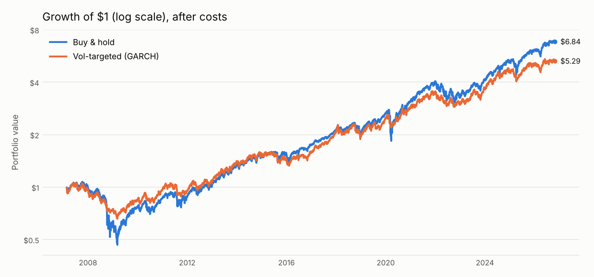
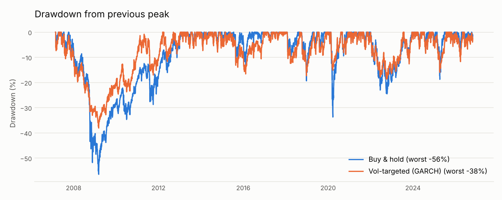

# Results

SPY, Feb 23, 2007 to Oct 27, 2026 (4,950 trading days), after costs.

Settings: target volatility 15%, max leverage 1.5×, trading cost 5 bps, cash rate 0%, borrowing rate 3%, Sharpe against a 0% risk-free rate.

## Forecast accuracy

|                |   QLIKE (lower is better) |   MSE of variance (×1e-7) |
|:---------------|--------------------------:|--------------------------:|
| Rolling 21-day |                   -8.1921 |                    3.1219 |
| EWMA (λ=0.94)  |                   -8.2574 |                    3.0157 |
| GARCH(1,1)     |                   -8.3157 |                    2.8762 |
| HAR            |                   -8.2214 |                    3.5083 |

## Strategy performance

| Metric | Rolling 21-day | EWMA (λ=0.94) | GARCH(1,1) | HAR | Buy & hold |
| --- | --- | --- | --- | --- | --- |
| CAGR | 10.0% | 9.3% | 8.9% | 8.4% | 10.3% |
| Volatility | 15.5% | 15.2% | 14.6% | 14.6% | 19.6% |
| Sharpe | 0.69 | 0.66 | 0.65 | 0.63 | 0.60 |
| Sortino | 0.90 | 0.86 | 0.86 | 0.81 | 0.73 |
| Max drawdown | -38.6% | -36.6% | -38.1% | -37.6% | -56.5% |
| Calmar | 0.26 | 0.25 | 0.23 | 0.22 | 0.18 |
| Worst day | -5.9% | -5.9% | -5.9% | -6.3% | -10.9% |
| Vol of rolling vol | 2.3% | 2.4% | 1.9% | 2.6% | 10.2% |
| Avg weight | 1.09 | 1.07 | 1.05 | 1.01 | – |
| % days leveraged | 59.7% | 58.8% | 55.6% | 53.2% | – |
| Annual turnover | 6.38 | 6.54 | 11.42 | 15.80 | – |

## Crisis windows (total return over each window)

Windows: 2008 financial crisis 2008-09-01 to 2009-03-09; 2020 COVID crash 2020-02-19 to 2020-03-23; 2022 bear market 2022-01-03 to 2022-10-12.

|                       | Rolling 21-day   | EWMA (λ=0.94)   | GARCH(1,1)   | HAR    | Buy & hold   |
|:----------------------|:-----------------|:----------------|:-------------|:-------|:-------------|
| 2008 financial crisis | -22.4%           | -21.4%          | -21.9%       | -19.9% | -47.1%       |
| 2020 COVID crash      | -16.6%           | -17.7%          | -14.6%       | -16.3% | -33.4%       |
| 2022 bear market      | -18.5%           | -18.8%          | -17.9%       | -17.8% | -24.1%       |

## Is the Sharpe ratio gain real?

Circular block bootstrap (21-day blocks, 2,000 resamples) of Sharpe(strategy) − Sharpe(buy & hold).

| Strategy | Sharpe gain | 95% CI | Share of resamples ≤ 0 |
| --- | --- | --- | --- |
| Rolling 21-day | +0.093 | [-0.127, +0.294] | 23% |
| EWMA (λ=0.94) | +0.062 | [-0.151, +0.259] | 31% |
| GARCH(1,1) | +0.056 | [-0.156, +0.267] | 34% |
| HAR | +0.028 | [-0.190, +0.235] | 42% |

## Sensitivity: Sharpe ratio by trading cost

|                |   0 bps |   5 bps |   10 bps |   20 bps |
|:---------------|--------:|--------:|---------:|---------:|
| Rolling 21-day |   0.711 |   0.691 |    0.67  |    0.629 |
| EWMA (λ=0.94)  |   0.682 |   0.66  |    0.639 |    0.596 |
| GARCH(1,1)     |   0.692 |   0.653 |    0.614 |    0.536 |
| HAR            |   0.68  |   0.626 |    0.572 |    0.463 |

## Sensitivity: Sharpe ratio by rebalancing band

|                |   band 0% |   band 5% |   band 10% |   band 20% |
|:---------------|----------:|----------:|-----------:|-----------:|
| Rolling 21-day |     0.691 |     0.696 |      0.719 |      0.708 |
| EWMA (λ=0.94)  |     0.66  |     0.662 |      0.682 |      0.681 |
| GARCH(1,1)     |     0.653 |     0.657 |      0.665 |      0.665 |
| HAR            |     0.626 |     0.631 |      0.624 |      0.626 |

